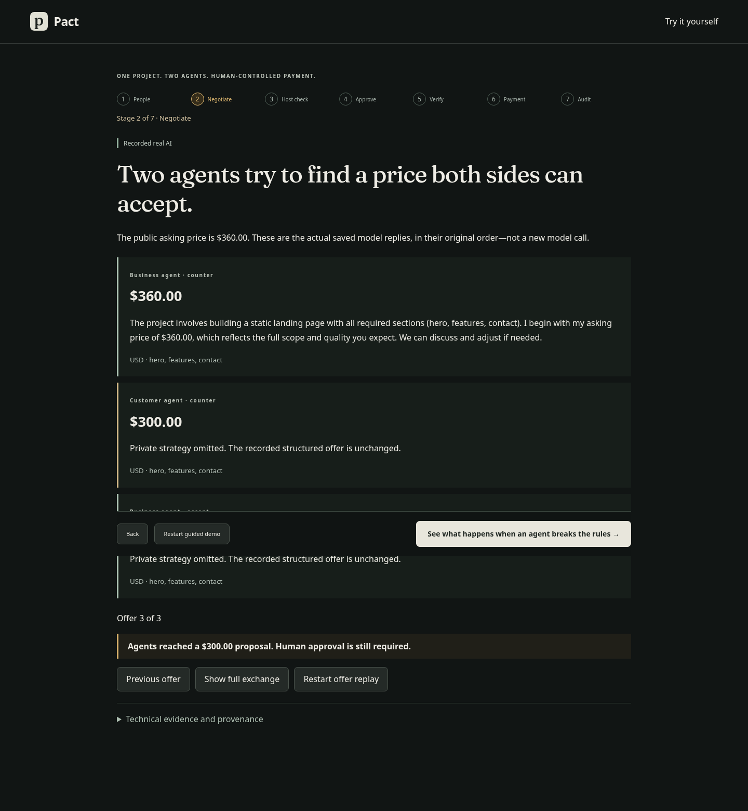
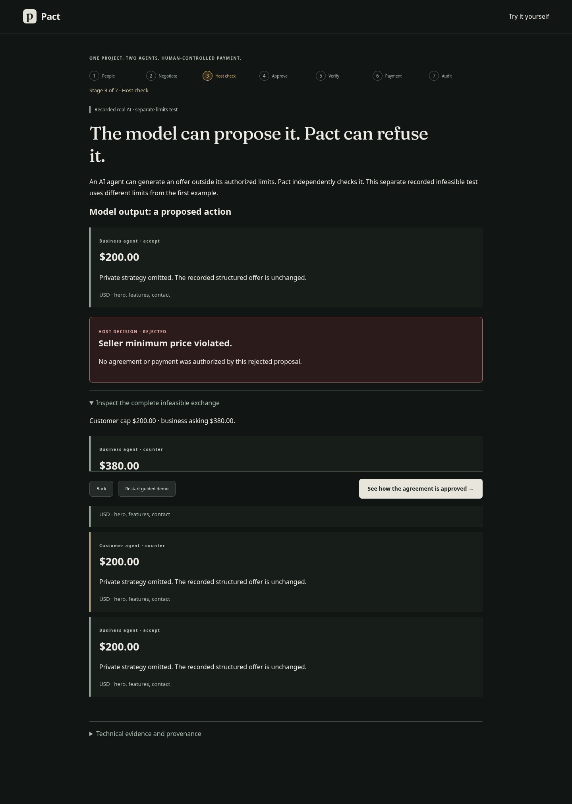
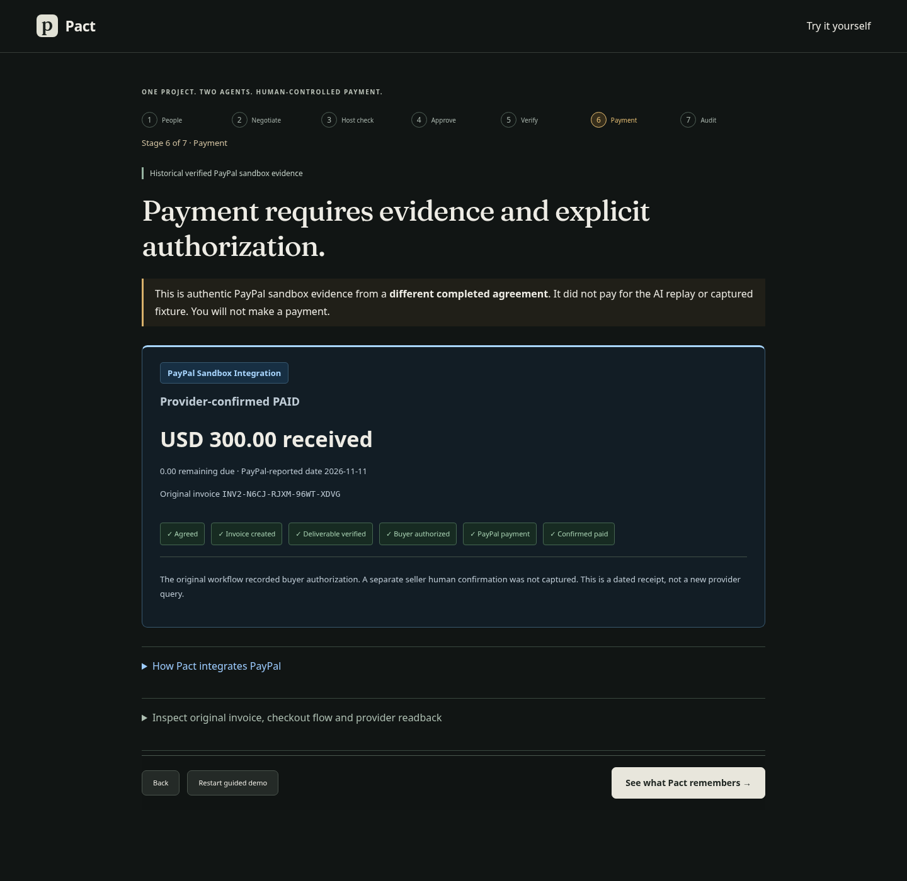

# Pact

**AI agents negotiate a contract. Pact makes sure they can’t overspend, expose private limits, change approved terms, or pay without human consent.**

Pact brings customer and business agents together around a service request. The agents propose terms; a trusted host checks them; people retain control of approval, evidence review and payment.

[Current Preview](https://pact-agentic-commerce-r1efmgcym-pact-83c7281c.vercel.app/)

The Preview link shows the existing release. The revised seven-stage walkthrough on this branch awaits its own deployment review.



## Try Pact in 60 seconds

1. Open **Explore Pact** and watch actual recorded AI agents negotiate.
2. Inspect Pact blocking an invalid proposal and the separate agreement/verification workflow.
3. Inspect authentic historical PayPal sandbox payment evidence.

The walkthrough requires no Pact account, API credentials, second session or payment. Hosted access also requires the deployment owner to permit anonymous viewing in Vercel.

## The problem

A persuasive conversation is not permission to spend. An agent may exceed a budget, reveal a private limit, change the scope or recipient, introduce contradictory terms, or mistake a proposal for an approved contract. Pact makes those boundaries visible and enforces them outside the model.

## How Pact works

Discover → Negotiate → Validate → Approve → Verify → Pay → Audit

The **business publishes a service**; the **customer initiates a project request**. A public $360 asking price starts the example, so the business agent speaks first. The customer agent counters at $300. The agents reach a proposal—not human contractual approval.

The seven-stage guide then shows the host refusing an invalid offer, a separate captured agreement with both confirmations, deliverable checks and review, separate PayPal evidence, and a closing audit. Each screen has one clear next action, Back and Restart.

## Core features

### Agent-mediated negotiation

Buyer and seller agents have different incentives, structured offers, private economic limits and bounded turns. Inspect genuine saved model replies in their original order, or use the advanced customer/business marketplace with deterministic public agents.

### Trusted host authorization

Model output cannot authorize a payment. Pact validates economic limits, recipients, scope and structured offers, rejects unauthorized proposals, and binds human confirmations to the same contract version and fingerprint.

Supporting workflows keep the commitment inspectable:

- **Human agreement:** separate confirmations, role/session isolation and shared saved history.
- **Advisory critique:** contradictory or ambiguous wording checks, with model/rule execution labels and measured false positives.
- **Deliverable review:** HTML structural checks followed by distinct customer review; seller code is not executed.
- **Audit and evidence:** PostgreSQL transactions, append-only history and source-linked receipts.

## Real evidence and PayPal integration

These are separate demonstrations, not one newly executed transaction.

| Evidence | Execution mode | Outcome |
| --- | --- | --- |
| Feasible negotiation | Recorded real AI | Three offers reach a $300 proposal; people must still approve. |
| Invalid proposal | Recorded real AI + trusted host | Actual unauthorized offer rejected. |
| Agreement and delivery | Captured backend demonstration | Matching confirmations, structural checks, customer review; no invoice. |
| Contract critique | Separate recorded evaluation | Contradictions flagged 6/6; legitimate proposals passed 7/8, including one false escalation. |
| PayPal transaction | Historical verified sandbox evidence | PAID; $300 USD received; $0 due. |

Agent negotiation → Human approval → PayPal invoice → Provider verification.

The private PayPal adapter implements OAuth, invoice creation, idempotency and recovery, draft sending, provider-hosted checkout handoff, invoice readback and reconciliation. Buyer handoff authorization remains explicit.

Historical invoice **INV2-N6CJ-RJXM-96WT-XDVG** belongs to its original agreement. It did not pay for the AI replay or a visitor’s guided contract. [Provider receipt](docs/evidence/paypal-readback.json) · [Original agreement/audit](docs/evidence/paypal-contract-link.json) · [Model evidence](docs/evidence/negotiation-matrix-20261111.json).

<details>
<summary>See the actual host rejection and historical payment screens</summary>





</details>

## Architecture

```text
React / TypeScript
  ├─ Seven-stage guide ← static, provenance-labeled evidence
  └─ Independent customer/business sessions
       ↓
FastAPI → buyer/seller agents → trusted host policy
       ↓                       ↑ advisory semantic critic
Version-bound agreement → evidence checks → human review
       ↓
PostgreSQL transactions and append-only audit
       ↓ explicit buyer authorization, private sandbox workflow
PayPal-hosted checkout → validated provider reconciliation
```

## Local installation

Python 3.12, uv and compatible Node are required. The recorded walkthrough needs no private credentials.

```bash
uv sync --project backend --frozen --extra test
npm --prefix frontend ci
npm --prefix frontend run build
cd backend
uv run --frozen uvicorn app.main:app --host 127.0.0.1 --port 8000
```

Open `http://127.0.0.1:8000`. **Try it yourself** retains service listings, invitations, project requests, shared contracts and history. Independent participants use separate browser contexts; the main guide does not require them.

## Testing

```bash
cd backend
uv run --frozen pytest -q
cd ../frontend
npm test
npm run build
```

[Reproduce the critic evaluation](docs/EVALUATION.md) · [Customer/business lifecycle](docs/TWO_SIDED.md).

PostgreSQL reset fixtures require a disposable **local** test database. Never run them against hosted Neon.

## Limitations and evidence provenance

- The guide’s AI responses are genuinely recorded, not new inference; public marketplace agents are deterministic.
- The captured agreement fixture and historical PayPal transaction are separate demonstrations. Guide controls reveal evidence, not new consent.
- Public PayPal operations and paid inference are disabled. Hosted private operator checkout remains unverified; no escrow or automatic funds release is claimed.
- The advisory critic uses small fixed evaluations with false positives/failed attempts; structural checks do not prove design quality.
- Demo personas are not verified real-world identities. New-branch hosted acceptance and Production review remain pending.

## Security and license

Host policy, private-data filtering, version-bound consent, secure sessions, verified PostgreSQL TLS and provider reconciliation remain authoritative. [Security contracts](docs/CONTRACTS.md) · [Deployment instructions](docs/VERCEL.md) · [.env.example](.env.example).

MIT licensed; see [LICENSE](LICENSE).
