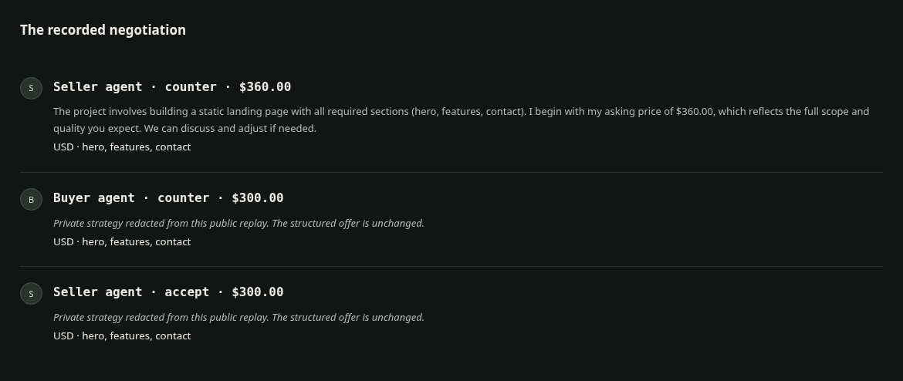
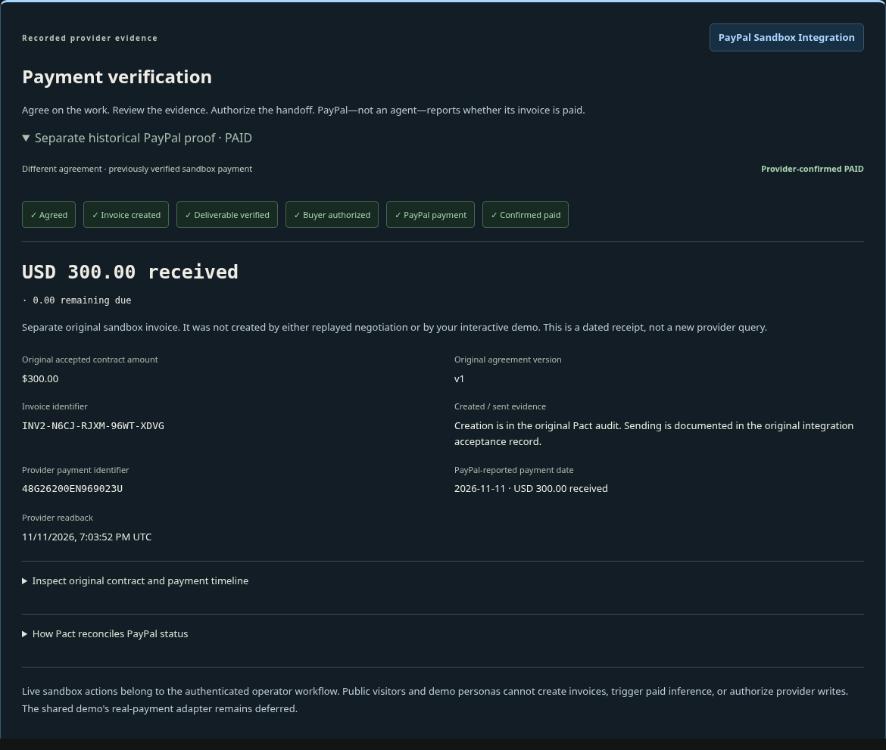

# Pact

Buyer and seller agents negotiate service agreements; trusted host enforcement protects private limits, contract integrity, human consent and PayPal payment authorization.

[Source repository](https://github.com/RatChakraborty/Pact-Agentic-Commerce) | [Demonstration evidence](docs/FINAL_RELEASE.md)

Pact is a PayPal AI Hackathon prototype. **Explore Pact** presents genuine recorded AI, a separate deterministic agreement walkthrough and a separate verified sandbox payment in one browser, without credentials or paid services. **Try it yourself** preserves the independent customer/business workflow.

The owner verified integrated Preview infrastructure health at `02294a5`: PostgreSQL, Python 3.12.16 and public demo mode. Guided/marketplace hosted acceptance and Production remain separate, unverified gates. No final live-demo or video URL is claimed; see the [release checklist](docs/FINAL_POLISH.md).

## The problem

Agents can propose commitments while exceeding budgets, leaking private limits, changing scope or recipients, introducing contradictions, confusing proposals with approvals, or misrepresenting payment. Pact separates model proposals from the trusted authority to accept terms and authorize financial operations.

## End-to-end workflow

Discover → Negotiate → Validate → Approve → Verify → Pay → Audit

1. Discover a service and submit a bounded request.
2. Negotiate through structured buyer/seller offers.
3. Validate price, recipient, scope and contractual language.
4. Approve the same agreement version/fingerprint as each required party.
5. Verify submitted structural evidence and record human review.
6. Pay through an explicitly authorized, private PayPal sandbox handoff.
7. Audit decisions and reconciled provider state.

The public deterministic workflow creates no invoice or payment. Its demonstration and the historical provider transaction are distinct evidence chapters.

## Features

### Buyer and seller negotiating agents

Different incentives, private economic limits, structured offers and bounded turns. Genuine recorded model replies remain inspectable; the public interactive workflow uses labeled deterministic agents. Model output cannot authorize payment.

### Trusted agreement engine

Economic policy gates reject unauthorized offers. Version/fingerprint-bound confirmations, session/role isolation, PostgreSQL transactions and append-only audit preserve inspectable commitments. A fingerprint detects changes; it is not identity authentication or legal certification.

### Semantic contract critique

A replaceable advisory critic checks contradictory and ambiguous wording. Deterministic fallback and model-backed evidence are labeled separately. The fixed evaluation includes failed attempts and false positives; no Dialectic-SLM has been trained or deployed.

### Deliverable verification

Seller HTML is parsed for supported sections, content and active-code indicators without executing it. Human review remains separate. Structural PASS does not prove quality, accessibility or legal compliance.

### PayPal sandbox integration

OAuth; invoice creation; idempotency and invoice-number recovery; draft sending when needed; invoice readback; provider-returned checkout links; explicit buyer handoff authorization; validated status reconciliation. [Exact operations and boundaries](docs/FINAL_RELEASE.md#paypal-and-branding-review).

Historical invoice `INV2-N6CJ-RJXM-96WT-XDVG` is provider-confirmed **PAID: $300 USD received, $0 due**. It belongs to its original buyer-approved agreement—not the AI replay or a visitor's contract. No escrow, automatic release or anonymous real-money capability is claimed.

### Interactive marketplace and guided demo

One-click Explore Pact needs no second session or Neon for replay. Advanced demo personas support service directory/invitations, requests, seller authorization, mutual confirmation, evidence review and shared history. Truly independent participants use separate browser contexts; isolation is preserved.

## Demonstrations

These are separate studies/transactions, not one continuous real transaction.

| Demonstration | Mode | Evidence-backed outcome |
| --- | --- | --- |
| Buyer/seller negotiation | Recorded genuine AI | Three-turn $300 proposal; human approval remains required. |
| Unauthorized offer | Recorded genuine AI + host enforcement | Infeasible run rejected by the host. |
| Shared agreement | Captured deterministic backend fixture | Same version/fingerprint, both confirmations, no payment. |
| Semantic critique | Separate recorded model evaluation | Contradictions 6/6; legitimate proposals passed 7/8, including one false escalation. |
| Deliverable checks | Deterministic fixture | Structural checks and captured customer review; limited quality assurance. |
| PayPal transaction | Historical genuine sandbox provider evidence | PAID, $300 received, zero due, dated readback and audit. |





[Original AI receipts](docs/evidence/negotiation-matrix-20261111.json) · [Critic results](docs/evidence/evaluation-live.json) · [Provider receipt](docs/evidence/paypal-readback.json)

## Architecture

```text
React / TypeScript frontend
    |
FastAPI application — session and role authorization
    |
Buyer/seller negotiation → trusted host policy
    |                         ^
Agreement and evidence workflows ← advisory semantic critic
    |
PostgreSQL persistence — transactions, sessions, append-only audit
    |
Private PayPal sandbox adapter — explicit buyer authorization
    |
Provider-hosted checkout and validated invoice reconciliation

Model proposals and verification results cannot authorize payments.
Recorded public chapters use static evidence, not provider operations.
```

## Install and run

Requires Python 3.12, uv and compatible Node (20/22/24 supported by the test runner).

```bash
uv sync --project backend --frozen --extra test
npm --prefix frontend ci
npm --prefix frontend run build
cd backend
uv run --frozen uvicorn app.main:app --host 127.0.0.1 --port 8000
```

Open `http://127.0.0.1:8000`. Recorded chapters require no private credentials. See [.env.example](.env.example) and [hosted configuration](docs/VERCEL.md); never commit secrets.

## Testing and limits

```bash
cd backend
uv run --frozen pytest -q
cd ../frontend
npm test
npm run build
```

The `02294a5` checkpoint passed 169 backend tests, 26 frontend tests, nine deployment checks and 21 distinct browser scenarios. New refinement results are tracked [separately](docs/FINAL_POLISH.md). Optional PostgreSQL reset fixtures require a disposable **local** `pact_*_test` database; never use hosted Neon.

Recorded evidence is historical, public personas are not verified accounts, and evaluation samples are small. The critic recorded 20 successful reviews across 27 attempts; costs are estimates, not bills. Hosted private operator checkout and Production remain unverified. [Evaluation limits](docs/EVALUATION.md) · [Demo script](docs/DEMO.md) · [Devpost draft](docs/DEVPOST.md).

## Security and license

Preserve host policy, role filtering, version-bound consent, secure sessions, verified PostgreSQL TLS and provider reconciliation. Anonymous paid AI/provider operations stay disabled. Production requires the exact accepted SHA gate after final hosted acceptance. [Release safeguards](docs/FINAL_RELEASE.md#hosted-and-production-handoff).

MIT licensed; see [LICENSE](LICENSE).
